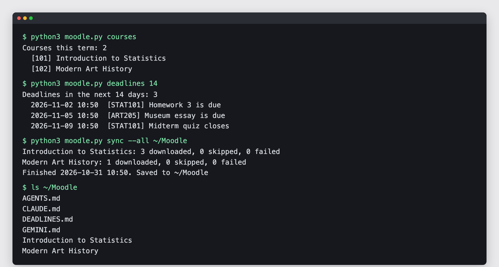
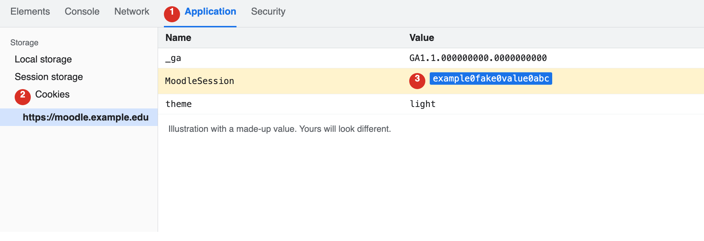

# moodle-student-kit

[繁體中文](README.zh-TW.md) | [简体中文](README.zh-CN.md)

**Paste one link into Claude Code and it sets up your Moodle with you.** It downloads your course files, puts your Moodle to-dos in one list, and shows you how to study with them. If you can use Claude Code, you can use this.



## Start here

Open Claude Code and paste this:

> Help me set up https://github.com/yyu0310/moodle-student-kit and follow its AGENTS.md step by step. I can't code, so explain each step in plain language and wait for me before moving on.

Claude Code handles the setup and stops at the one step you do yourself, which is signing in.

## What you get

| What you get | Why it helps |
| --- | --- |
| The files in this term's course sections, sorted by section | Find slides without clicking through Moodle |
| Attachments on the first post of each forum thread | Teachers often put readings in announcements, where they're easy to miss |
| `DEADLINES.md`, the to-dos from Moodle's calendar across all your courses | See what's due at a glance, with a link to each page |
| `INDEX.md` for each course, with update dates | Claude Code can find the newest file quickly |
| A daily automatic sync | New slides appear in your folder on their own |
| Safe notes | Your edits are never overwritten. If a teacher replaces a file, your old copy stays beside the new one |

## What you need

- A Mac, Windows or Linux computer
- A Moodle account at your school
- Python 3.9 or newer, which Claude Code can check for you
- Claude Code

## Setup

| Claude Code can do this | You do this yourself |
| --- | --- |
| Check Python and download the tool | Sign in to Moodle |
| Test the connection and run the first sync | Copy the cookie from your browser |
| Set up the daily sync | Run the `login` command in your own terminal |

### Install the security starter first

[claude-code-security-starter](https://github.com/yyu0310/claude-code-security-starter) stops Claude Code from reading files that hold passwords and keys, including the one this tool saves. Claude Code will offer to install it during setup.

### Sign in

Many schools sign in through a campus portal, so there's no Moodle password to use. This tool borrows your browser's sign-in once and swaps it for a long-lasting key.

1. Open Moodle in Chrome or Edge and sign in. Wait for your dashboard to finish loading.
2. Press F12, or Option + Command + I on a Mac, and open the **Application** tab. If you can't see it, click `>>`. In Firefox, the tab is called **Storage**.
3. Under **Cookies**, click your Moodle address. Find the row that starts with `MoodleSession`, double-click its **Value** and copy it.

   

4. Open a separate terminal window, outside Claude Code. On Windows, use `py` in place of `python3`.
5. Run these commands, paste the value when asked, and press Enter. Nothing appears while you paste, and that's normal.

```bash
cd ~/moodle-student-kit
python3 moodle.py login https://your-moodle-address
```

You'll see `Signed in to <your school> as <your username>.` when it works. If you see a line starting with `Error:`, send that line to Claude Code. It never contains your cookie.

Copy the cookie after your dashboard has loaded. Moodle creates a new session when you sign in, so a value copied earlier sends you back to the login page.

**Don't let Claude Code do this step, and don't paste the cookie into a chat.** It works like your password until you log out.

If your Moodle has **Preferences > Security keys**, you can skip F12. Copy the key on the **Moodle mobile web service** row and run `python3 moodle.py login https://your-moodle-address --token`.

Your sign-in is saved in `~/.moodle-student-kit/credentials.json`. On Mac and Linux, other accounts can't read that file, but any program you run can.

**What the saved key can do.** Apart from `upload`, this tool's commands only read Moodle, but the key itself can do anything you can do there, including submitting work. Treat it like your password.

## Everyday commands

You can ask Claude Code to run these. To type them yourself, run `cd ~/moodle-student-kit` first. Replace `123` with the number in square brackets from `courses`.

| Command | What it does |
| --- | --- |
| `python3 moodle.py info` | Checks that everything works |
| `python3 moodle.py courses` | Lists the courses Moodle marks as in progress |
| `python3 moodle.py deadlines 14` | Shows what's due in the next 14 days |
| `python3 moodle.py grades` | Shows your overall grade in each course |
| `python3 moodle.py contents 123` | Lists the sections and files of course 123 |
| `python3 moodle.py sync 123 ~/Statistics` | Downloads one course |
| `python3 moodle.py sync --all ~/Moodle` | Downloads those courses and writes `DEADLINES.md` |
| `python3 moodle.py assignments` | Lists assignments with their ids and due dates |

Add `--json` to `info`, `courses`, `deadlines`, `grades`, `contents` or `assignments` for output that other programs can read.

## Uploading an assignment (not recommended)

Hand work in on Moodle's website when you can, so you can see exactly what you're submitting. This command is there if you really want it.

```bash
python3 moodle.py assignments                  # find the assignment id
python3 moodle.py upload 456 ~/homework.pdf
```

- Run it in a separate terminal, outside Claude Code. It refuses to run inside Claude Code, which helps stop a course file from tricking it into handing anything in. That's a safeguard, and a determined program could get past it.
- It shows the assignment and the file, and you type `UPLOAD` to continue.
- It won't touch a submission that already holds your files or text, and it refuses anything that looks like a password or key file.
- Some assignments need you to press Submit on the website afterwards, and the command tells you when. Assignments without a Submit step normally count as handed in once saved.
- Check the result on the website. What you hand in is your responsibility.

### Let Claude Code hand work in (off by default)

If you'd rather have Claude Code do this, turn it on yourself in a separate terminal:

```bash
python3 moodle.py ai-upload on    # type ALLOW AI UPLOAD to confirm
python3 moodle.py ai-upload off   # turn it back off
```

- Claude Code can then run `upload 456 ~/homework.pdf --auto`, which uploads the file and presses Submit. Submitted work usually can't be changed.
- With this on, a course file could try to trick Claude Code into handing something in. Turn it on only if you accept that risk.
- If an assignment asks you to accept a statement, it stops at a draft and you press Submit yourself. That promise is yours to make.
- Signing in again turns this off. The switch needs a real terminal, which is a safeguard and not a wall.

## Ideas to try with Claude Code

Open Claude Code inside your `~/Moodle` folder. Each sync leaves a set of rules there that tell it how to handle your files.

| Say this | What you get |
| --- | --- |
| "Sync my Moodle and tell me what's due this week." | New files, and a short list of deadlines |
| "Turn my deadlines into a plan for this week." | A day-by-day plan |
| "Explain this week's slides in plain language." | A summary you can read before class |
| "Quiz me on chapter 3, one question at a time." | Practice questions, with the wrong answers explained |
| "Which file talks about regression?" | The file and page |
| "How am I doing in my courses?" | Your grades, and the to-dos still open |

## Works with

| Tool | Status |
| --- | --- |
| Claude Code | Tested with a simulated student on a fake site |
| macOS | Tested on Python 3.9 and 3.14 |
| Windows, Linux | Should work the same, not tested |
| Moodle | Reading and sync tested on one school's Moodle 4.5. On that site, sign-in was tested with a fake cookie. Trading a real cookie for a key follows Moodle's source code and hasn't run yet |

## Limitations

- `upload` is the only command that changes anything on Moodle. It and `--auto` have only been tested on a fake site, not on a real assignment. No command posts, takes quizzes or reads quizzes.
- `DEADLINES.md` lists Moodle's calendar to-dos. Dates that appear only in slides or announcements won't be there, so Moodle and your teacher have the final word.
- Files attached to assignment instructions, replies in forum threads, and files on other sites aren't downloaded. Videos stored in Moodle are, and they can be large.
- Sign-in depends on your school. It suits schools that sign in through a campus portal. Schools with ordinary Moodle passwords may refuse it, and schools that turn off the Moodle mobile web service can't use this tool.
- Your sign-in expires, after 12 weeks on a default Moodle. Sign in again when it does.
- The daily sync only runs while your computer is on and awake.
- `INDEX.md` and `DEADLINES.md` are rewritten on every sync, so keep your notes in other files.

## Stop using it

1. Delete the `~/.moodle-student-kit` folder.
2. Ask Claude Code to remove the daily sync.
3. Reset the key on Moodle's Security keys page if you have one. Logging out doesn't cancel it. Otherwise it stops working when it expires.

## Use it responsibly

- Claude Code sends Anthropic your grades, username and course names when it runs these commands, and any file it opens
- Follow your school's rules, and check your course's rules on AI first.
- This project isn't affiliated with Moodle. Moodle is a registered trademark of Moodle Pty Ltd.

## For developers

```bash
python3 -m unittest discover tests   # offline tests
python3 tests/fake_moodle.py         # a fake site to try the tool without an account
```

Design notes are in [AGENTS.md](AGENTS.md).

## License

[MIT](LICENSE)
