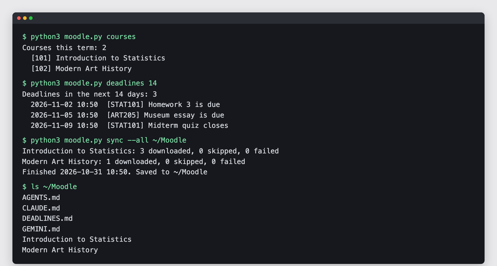
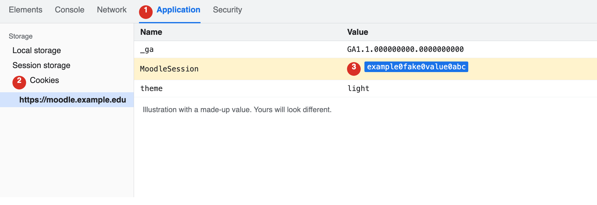

# moodle-student-kit

[English](README.md) | [繁體中文](README.zh-TW.md)

**把一个链接贴给 Claude Code，它就会带你把 Moodle 设置好。** 课程文件自动下载，Moodle 的待办整理成一份清单，还会教你怎么用这些资料学习。会用 Claude Code 就能用。



## 从这里开始

打开 Claude Code，粘贴这段话：

> 帮我安装 https://github.com/yyu0310/moodle-student-kit ，按照里面的 AGENTS.md 一步一步做。我不会写代码，每一步请用大白话解释，等我回复再继续。

安装过程由 Claude Code 处理，只有登录这一步要你自己做，它做到这里会停下来等你。

## 你会得到什么

| 你会得到 | 为什么有用 |
| --- | --- |
| 本学期各课章节里的文件，按章节分好 | 不用在 Moodle 里一层层点 |
| 讨论区每个主题第一帖的附件 | 老师常把讲义放在公告里，很容易漏掉 |
| `DEADLINES.md`，所有课在 Moodle 日历上的待办 | 一眼看完什么时候要交什么，每项都附页面链接 |
| 每门课一份 `INDEX.md`，附更新日期 | Claude Code 能很快找到最新的文件 |
| 每天自动同步 | 新讲义会自己出现在文件夹里 |
| 笔记不会被覆盖 | 你改过的文件不会被覆盖；老师换文件时，旧文件会留在新文件旁边 |

## 你需要准备

- 一台 Mac、Windows 或 Linux 电脑
- 学校的 Moodle 账号
- Python 3.9 以上，Claude Code 可以帮你检查
- Claude Code

## 安装

| Claude Code 可以代劳 | 要你自己做 |
| --- | --- |
| 检查 Python、下载工具 | 登录 Moodle |
| 测试连接、跑第一次同步 | 从浏览器复制 cookie |
| 设置每天自动同步 | 在自己的终端执行 `login` 命令 |

### 先装 security starter

[claude-code-security-starter](https://github.com/yyu0310/claude-code-security-starter) 能阻止 Claude Code 读取存放密码和密钥的文件，包括这个工具存的那份。安装过程中 Claude Code 会问你要不要装。

### 登录

很多学校是从校务门户统一登录，没有 Moodle 专用密码可以用。这个工具会借用浏览器的登录状态一次，换成一把可以长期使用的钥匙。

1. 用 Chrome 或 Edge 打开 Moodle 并登录，等仪表板完全加载。
2. 按 F12，Mac 按 Option + Command + I，打开“Application”标签页。看不到的话，点 `>>`。Firefox 的标签页叫“Storage”。
3. 在“Cookies”下面点你的 Moodle 网址，找到开头是 `MoodleSession` 的那一行，双击“Value”的值并复制。

   

4. 另外开一个终端窗口，不要在 Claude Code 里操作。Windows 要把 `python3` 换成 `py`。
5. 执行下面的命令，看到提示后粘贴刚才的值，按 Enter。粘贴时屏幕不会显示任何字，这是正常的。

```bash
cd ~/moodle-student-kit
python3 moodle.py login https://你的-moodle-网址
```

成功时会看到 `Signed in to <学校> as <账号>.`。如果出现 `Error:` 开头的信息，把那一行发给 Claude Code，里面不会有 cookie。

一定要等仪表板加载后才复制 cookie。Moodle 登录时会换新的 session，太早复制的值会被踢回登录页。

**这一步不要让 Claude Code 代做，也不要把 cookie 贴到对话里。** 在你退出登录之前，它的效力就跟密码一样。

如果你的 Moodle 有“偏好设置 > 安全密钥”，可以跳过 F12。复制“Moodle mobile web service”那一行的密钥，再执行 `python3 moodle.py login https://你的-moodle-网址 --token`。

登录信息存在 `~/.moodle-student-kit/credentials.json`。在 Mac 和 Linux 上，其他账号读不到这个文件，但你运行的程序都读得到。

**这把钥匙能做什么。** 这个工具的命令只会读取 Moodle，但钥匙本身能做你在 Moodle 上能做的所有事，包括交作业。请把它当成密码保管。

## 日常命令

这些命令可以请 Claude Code 帮你跑。要自己输入的话，先执行 `cd ~/moodle-student-kit`。把 `123` 换成 `courses` 列出的方括号数字。

| 命令 | 功能 |
| --- | --- |
| `python3 moodle.py info` | 检查一切是否正常 |
| `python3 moodle.py courses` | 列出 Moodle 标记为进行中的课 |
| `python3 moodle.py deadlines 14` | 显示未来 14 天的截止日期 |
| `python3 moodle.py grades` | 显示每门课的总成绩 |
| `python3 moodle.py contents 123` | 列出课程 123 的章节和文件 |
| `python3 moodle.py sync 123 ~/统计学` | 下载一门课 |
| `python3 moodle.py sync --all ~/Moodle` | 下载这些课，并生成 `DEADLINES.md` |

在 `info`、`courses`、`deadlines`、`grades`、`contents` 后面加 `--json`，输出就能给其他程序读取。

## 可以跟 Claude Code 这样说

请在 `~/Moodle` 文件夹里打开 Claude Code。每次同步都会在那里留一份规则，告诉它怎么处理你的文件。

| 这样说 | 你会得到 |
| --- | --- |
| “帮我同步 Moodle，告诉我这周要交什么。” | 新文件，加上一份简短的截止日期清单 |
| “把截止日期排成这周的学习计划。” | 每天要做什么 |
| “用大白话解释这周的讲义。” | 课前可以先看的摘要 |
| “考我第三章，一次问一题。” | 练习题，答错时会解释 |
| “哪个文件讲到回归？” | 文件名和页数 |
| “我这学期的课学得怎么样？” | 目前成绩和还没完成的待办 |

## 支持的工具

| 工具 | 状态 |
| --- | --- |
| Claude Code | 已用模拟学生在假站点测试 |
| macOS | 已在 Python 3.9 和 3.14 测试 |
| Windows、Linux | 理论上相同，未实测 |
| Moodle | 读取和同步已在一所学校的 Moodle 4.5 测试。登录在该站用假 cookie 测过；用真 cookie 换钥匙的步骤依 Moodle 源码编写，尚未实跑 |

## 限制

- 命令只会读取。不能交作业、发帖或作答，也不会读测验题目。
- `DEADLINES.md` 只列 Moodle 日历上的待办。只写在讲义或公告里的日期不会出现，一切以 Moodle 和老师公告为准。
- 作业说明的附件、讨论帖的回复、其他网站上的文件都不会下载。存在 Moodle 里的视频会下载，文件可能很大。
- 能否登录要看学校。从校务门户统一登录的学校比较适合；使用普通 Moodle 密码的学校可能会拒绝；关闭 Moodle mobile web service 的学校无法使用。
- 登录会过期，Moodle 默认是 12 周。过期后重新登录就好。
- 每天自动同步只会在电脑开机且没有休眠时执行。
- `INDEX.md` 和 `DEADLINES.md` 每次同步都会重写，笔记请记在别的文件。

## 停止使用

1. 删除 `~/.moodle-student-kit` 文件夹。
2. 请 Claude Code 移除每天自动同步。
3. 如果 Moodle 有安全密钥页面，到那里重置密钥。退出登录不会让密钥失效；没有这个页面的话，密钥要到过期才会停用。

## 使用须知

- 课程文件属于老师和学校，请留在自己手上，不要公开。
- Claude Code 执行这些命令时，会把你的成绩、账号和课程名称传给 Anthropic，打开的文件也一样。请先确认课程对 AI 的规定。
- 学校可能不允许长期钥匙或自动下载。遵守校规是你自己的责任。
- 本项目与 Moodle 官方无关。Moodle 是 Moodle Pty Ltd 的注册商标。

## 开发者

```bash
python3 -m unittest discover tests   # 离线测试
python3 tests/fake_moodle.py         # 假站点，没有账号也能试用
```

设计说明在 [AGENTS.md](AGENTS.md)。

## 许可证

[MIT](LICENSE)
