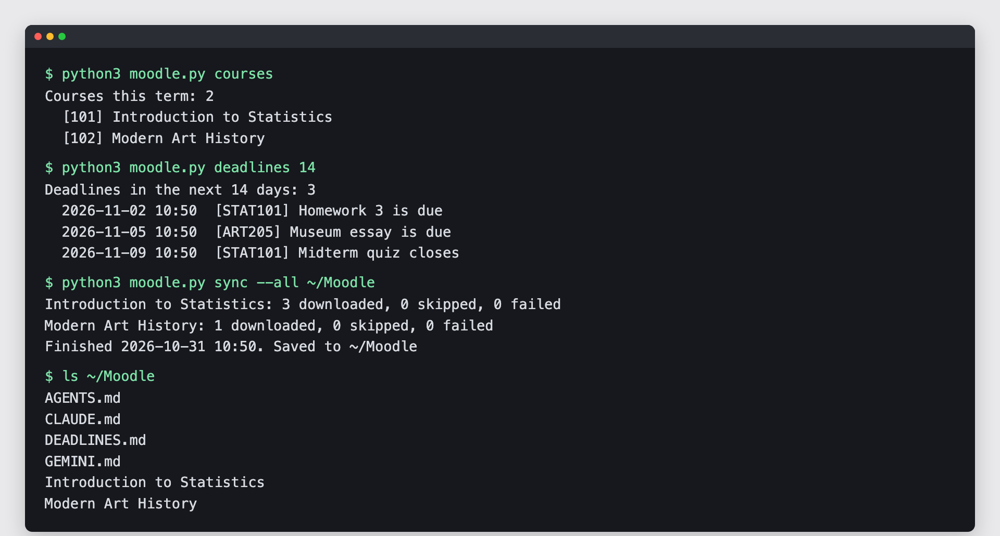
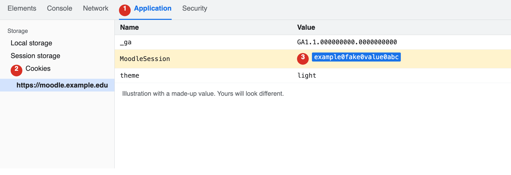

# moodle-student-kit

[English](README.md) | [简体中文](README.zh-CN.md)

**把一個連結貼給 Claude Code，它就會帶你把 Moodle 設定好。** 課程檔案自動下載，Moodle 的待辦整理成一份清單，還會教你怎麼拿這些資料讀書。會用 Claude Code 就能用。



## 從這裡開始

打開 Claude Code，貼上這段話：

> 幫我安裝 https://github.com/yyu0310/moodle-student-kit ，照著裡面的 AGENTS.md 一步一步做。我不會寫程式，每一步請用白話解釋，等我回覆再往下。

安裝過程由 Claude Code 處理，只有登入這一步要你自己做，它做到這裡會停下來等你。

## 你會得到什麼

| 你會得到 | 為什麼有用 |
| --- | --- |
| 本學期各課章節裡的檔案，依章節分好 | 不用在 Moodle 裡一層層點 |
| 討論區每串第一則貼文的附件 | 老師常把講義放在公告裡，很容易漏掉 |
| `DEADLINES.md`，所有課在 Moodle 行事曆上的待辦 | 一眼看完什麼時候要交什麼，每項都附頁面連結 |
| 每門課一份 `INDEX.md`，附更新日期 | Claude Code 能很快找到最新的檔案 |
| 每天自動同步 | 新講義會自己出現在資料夾裡 |
| 筆記不會被蓋掉 | 你改過的檔案不會被覆蓋；老師換檔時，舊檔會留在新檔旁邊 |

## 你需要準備

- 一台 Mac、Windows 或 Linux 電腦
- 學校的 Moodle 帳號
- Python 3.9 以上，Claude Code 可以幫你檢查
- Claude Code

## 安裝

| Claude Code 可以代勞 | 要你自己做 |
| --- | --- |
| 檢查 Python、下載工具 | 登入 Moodle |
| 測試連線、跑第一次同步 | 從瀏覽器複製 cookie |
| 設定每天自動同步 | 在自己的終端機執行 `login` 指令 |

### 先裝 security starter

[claude-code-security-starter](https://github.com/yyu0310/claude-code-security-starter) 能阻止 Claude Code 讀取存放密碼和金鑰的檔案，包括這個工具存的那份。安裝過程中 Claude Code 會問你要不要裝。

### 登入

很多學校是從校務入口單一登入，沒有 Moodle 專用密碼可以用。這個工具會借用瀏覽器的登入狀態一次，換成一把可以長期使用的鑰匙。

1. 用 Chrome 或 Edge 打開 Moodle 並登入，等儀表板完全載入。
2. 按 F12，Mac 按 Option + Command + I，打開「Application」分頁。看不到的話，點 `>>`。Firefox 的分頁叫「Storage」。
3. 在「Cookies」底下點你的 Moodle 網址，找到開頭是 `MoodleSession` 的那一列，雙擊「Value」的值並複製。

   

4. 另外開一個終端機視窗，不要在 Claude Code 裡操作。Windows 要把 `python3` 換成 `py`。
5. 執行下面的指令，看到提示後貼上剛才的值，按 Enter。貼上時畫面不會顯示任何字，這是正常的。

```bash
cd ~/moodle-student-kit
python3 moodle.py login https://你的-moodle-網址
```

成功時會看到 `Signed in to <學校> as <帳號>.`。如果出現 `Error:` 開頭的訊息，把那一行傳給 Claude Code，裡面不會有 cookie。

一定要等儀表板載入後才複製 cookie。Moodle 登入時會換新的 session，太早複製的值會被踢回登入頁。

**這一步不要讓 Claude Code 代做，也不要把 cookie 貼到對話裡。** 在你登出之前，它的效力就跟密碼一樣。

如果你的 Moodle 有「偏好設定 > 安全金鑰」，可以跳過 F12。複製「Moodle mobile web service」那一列的金鑰，再執行 `python3 moodle.py login https://你的-moodle-網址 --token`。

登入資訊存在 `~/.moodle-student-kit/credentials.json`。在 Mac 和 Linux 上，其他帳號讀不到這個檔案，但你執行的程式都讀得到。

**這把鑰匙能做什麼。** 這個工具的指令只會讀取 Moodle，但鑰匙本身能做你在 Moodle 上能做的所有事，包括交作業。請把它當成密碼保管。

## 日常指令

這些指令可以請 Claude Code 幫你跑。要自己輸入的話，先執行 `cd ~/moodle-student-kit`。把 `123` 換成 `courses` 列出的方括號數字。

| 指令 | 功能 |
| --- | --- |
| `python3 moodle.py info` | 檢查一切是否正常 |
| `python3 moodle.py courses` | 列出 Moodle 標記為進行中的課 |
| `python3 moodle.py deadlines 14` | 顯示未來 14 天的截止日 |
| `python3 moodle.py grades` | 顯示每門課的總成績 |
| `python3 moodle.py contents 123` | 列出課程 123 的章節和檔案 |
| `python3 moodle.py sync 123 ~/統計學` | 下載一門課 |
| `python3 moodle.py sync --all ~/Moodle` | 下載這些課，並產生 `DEADLINES.md` |

在 `info`、`courses`、`deadlines`、`grades`、`contents` 後面加 `--json`，輸出就能給其他程式讀取。

## 可以跟 Claude Code 這樣說

請在 `~/Moodle` 資料夾裡打開 Claude Code。每次同步都會在那裡留一份規則，告訴它怎麼處理你的檔案。

| 這樣說 | 你會得到 |
| --- | --- |
| 「幫我同步 Moodle，告訴我這週要交什麼。」 | 新檔案，加上一份簡短的截止日清單 |
| 「把截止日排成這週的讀書計畫。」 | 每天要做什麼 |
| 「用白話解釋這週的講義。」 | 課前可以先看的摘要 |
| 「考我第三章，一次問一題。」 | 練習題，答錯時會解釋 |
| 「哪個檔案講到迴歸？」 | 檔名和頁數 |
| 「我這學期的課修得怎麼樣？」 | 目前成績和還沒完成的待辦 |

## 支援的工具

| 工具 | 狀態 |
| --- | --- |
| Claude Code | 已用模擬學生在假站台測試 |
| macOS | 已在 Python 3.9 和 3.14 測試 |
| Windows、Linux | 理論上相同，未實測 |
| Moodle | 讀取和同步已在一所學校的 Moodle 4.5 測試。登入在該站用假 cookie 測過；用真 cookie 換鑰匙的步驟依 Moodle 原始碼撰寫，尚未實跑 |

## 限制

- 指令只會讀取。不能交作業、發文或作答，也不會讀測驗題目。
- `DEADLINES.md` 只列 Moodle 行事曆上的待辦。只寫在講義或公告裡的日期不會出現，一切以 Moodle 和老師公告為準。
- 作業說明的附件、討論串的回覆、其他網站上的檔案都不會下載。存在 Moodle 裡的影片會下載，檔案可能很大。
- 能否登入要看學校。從校務入口單一登入的學校比較適合；使用一般 Moodle 密碼的學校可能會拒絕；關閉 Moodle mobile web service 的學校無法使用。
- 登入會過期，Moodle 預設是 12 週。過期後重新登入就好。
- 每天自動同步只會在電腦開機且沒有睡眠時執行。
- `INDEX.md` 和 `DEADLINES.md` 每次同步都會重寫，筆記請記在別的檔案。

## 停止使用

1. 刪除 `~/.moodle-student-kit` 資料夾。
2. 請 Claude Code 移除每天自動同步。
3. 如果 Moodle 有安全金鑰頁面，到那裡重設金鑰。登出不會讓金鑰失效；沒有這個頁面的話，金鑰要到過期才會停用。

## 使用須知

- Claude Code 執行這些指令時，會把你的成績、帳號和課程名稱傳給 Anthropic，打開的檔案也一樣
- 遵守校規，請先確認課程對 AI 的規定。
- 本專案與 Moodle 官方無關。Moodle 是 Moodle Pty Ltd 的註冊商標。

## 開發者

```bash
python3 -m unittest discover tests   # 離線測試
python3 tests/fake_moodle.py         # 假站台，沒有帳號也能試用
```

設計說明在 [AGENTS.md](AGENTS.md)。

## 授權

[MIT](LICENSE)
